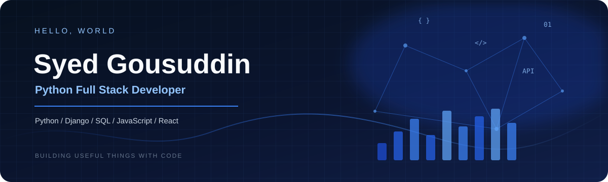

  <picture>
    <source media="(prefers-reduced-motion: reduce)" srcset="./abdul-hero-static.svg">
    
  </picture>

 

<table>
<tr>
<td width="210" align="center" valign="top">
  
</td>
<td valign="top">

## About

Computer Science and Engineering graduate focused on Python Full Stack Development. I build web applications using Python, Django, SQL, JavaScript, and modern frontend tools. I enjoy creating clean interfaces, working with databases, integrating APIs, and solving practical problems through code.

I'm looking for **Python Developer** and **Full Stack Developer** opportunities.

</td>
</tr>
</table>

<!-- Replace the LinkedIn URL below with your actual profile URL -->

---

## Experience

**Python Full Stack Development Intern / Trainee**  
*Pentagon Space Institute*

- Practised Python programming, SQL, HTML, CSS, JavaScript, and Django.
- Built full-stack features and connected frontend pages with backend functionality.
- Worked with relational databases, REST-style endpoints, and responsive UI components.

## Education

**B.E. — Computer Science & Engineering**  
Visvesvaraya Technological University (VTU)

## Selected Projects

| Project | What it does | Stack |
|---|---|---|
| **Civiconnect** | Civic issue reporting system for citizens to submit issues, track status, and support department/admin workflows. Includes map-based locations, notifications, audit logs, and reporting features. | Python, Django, PostgreSQL, HTML, CSS, JavaScript, Bootstrap, Leaflet.js, Chart.js |
| **JavaScript API Practice** | Fetches product data from a REST API and displays results in a responsive card layout. | JavaScript, Fetch API, HTML, CSS |
| **Python & SQL Practice** | Programming exercises covering problem solving, data structures, SQL queries, and database fundamentals. | Python, SQL |

> Add repository links to each project title after confirming the projects are pushed to your GitHub account.

---

## Skills

| | |
|---|---|
| **Programming** | Python, JavaScript, C++ |
| **Frontend** | HTML5, CSS3, Bootstrap, React, DOM, Fetch API |
| **Backend** | Django, REST APIs |
| **Database** | SQL, PostgreSQL |
| **Tools** | Git, GitHub, VS Code, Postman |
| **Libraries** | Chart.js, Leaflet.js |

---

## Contribution Heatmap

  
   
  Live data from my GitHub contributions.

## GitHub Stats

  
  

---

  <picture>
    <source media="(prefers-reduced-motion: reduce)" srcset="./abdul-footer-static.svg">
    
  </picture>

