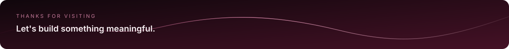

  

---

## About Me

<table>
<tr>
<td width="190" align="center" valign="middle">

</td>
<td valign="middle">

I'm a Computer Science and Engineering graduate focused on building practical web applications and modern full-stack solutions.

I enjoy turning ideas into working products—from designing user interfaces and APIs to connecting databases and debugging end-to-end workflows.

Currently developing my skills in **Python Full Stack Development** through hands-on training at **Pentagon Space**.

**Interested in:** Python Developer · Django Developer · Full-Stack Developer

</td>
</tr>
</table>

---

## 🎓 Education

**B.E. — Computer Science & Engineering**

Shetty Institute of Technology, Kalaburagi  
Visvesvaraya Technological University (VTU) · 2026

**PUC — Diamond Independent PU College**

Bhalki, Bidar · 2022

---

## 💼 Training

**Python Full Stack Development — Pentagon Space**

Bengaluru, India

- Python programming and object-oriented programming.
- SQL and relational database fundamentals.
- HTML, CSS, JavaScript, Bootstrap and Django templates.
- Full-stack application development and REST API integration.
- Git, GitHub and deployment fundamentals.

---

## 🧰 Technical Skills

| Category | Technologies |
|---|---|
| **Languages** | Python, JavaScript, SQL, HTML, CSS |
| **Backend** | Django, Django REST Framework |
| **Frontend** | React.js, Bootstrap |
| **Database** | MySQL, PostgreSQL |
| **Libraries** | Chart.js, Leaflet.js |
| **API & Tools** | REST APIs, Git, GitHub, VS Code, Postman |
| **Core Concepts** | OOP, CRUD, database design, debugging, responsive UI |

---

## 🚀 Selected Projects

### CivicConnect — Civic Issue Reporting System

A full-stack civic platform designed to help citizens report local issues and track their progress through an administrative dashboard.

**Technologies:** Python, Django, PostgreSQL, HTML, CSS, JavaScript, Bootstrap, Leaflet.js, Chart.js

### BrainScan — MRI Image Classification

An AI-assisted MRI image classification project focused on image processing and model-based predictions.

**Technologies:** Python, deep learning / CNN workflow

### Leave Management System

A web application for submitting, reviewing and managing employee leave requests.

**Technologies:** Python, Django, SQL, HTML, CSS, Bootstrap

---

## 📜 Certifications

- Privacy and Security in Online Social Media — NPTEL
- K-Tech CoE for Cyber Security
- Applied Artificial Intelligence

---

## 📈 GitHub Contributions

Contribution data is supplied by a third-party service and may occasionally be unavailable.

---

## 📊 GitHub Statistics

Statistics are generated by an external service and may be rate-limited.

---

**Thanks for visiting my profile!**

